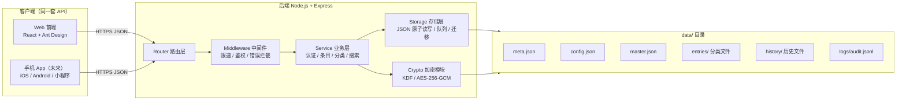

# 密码本系统 · 开发设计文档

| 项目 | 内容 |
| --- | --- |
| 文档版本 | v1.2 |
| 编写日期 | 2026-11-16 |
| 状态 | 已实现（代码与本文档同步） |
| 关联文档 | [02-统一开发规范](./02-统一开发规范.md)、[03-API接口文档](./03-API接口文档.md) |

---

## 1. 项目概述

### 1.1 项目背景

个人账号密码管理需求：统一记录一系列网站/应用的账号、密码、备注等信息，避免遗忘与重复使用弱口令。

### 1.2 项目目标

1. 提供 Web 端密码本系统，支持账号密码的增删改查、分类、搜索、收藏、历史版本。
2. 数据以 **JSON 文件**形式直接存放在项目 `data/` 目录下，**不依赖任何外部数据库**，便于备份、迁移与人工查看。
3. 后端提供**统一的 RESTful API**，前端（Ant Design Web）与未来手机 App 调用**同一套接口**，保证多端一致。
4. 密码敏感字段**加密落盘**，服务端不保存主密码明文，中途截获网络数据也无法解密。

### 1.3 范围与非目标

**范围内（V1.0）**

- Web 端（Ant Design）：登录/解锁、分类管理、条目增删改查、搜索过滤、密码生成器、复制到剪贴板、查看历史版本。
- 后端（Node.js + Express）：REST API、主密码校验、字段加解密、JSON 文件读写与并发串行化。
- 数据：`data/` 目录下的 JSON 文件存储与版本迁移机制。

**非目标（V1.0 暂不做）**

- 多用户/多租户、云端同步、账号体系。
- 浏览器插件自动填充、iOS/Android 原生 App（预留 API，后续迭代）。
- 导出明文文件、TOTP 二要素、附件存储。

### 1.4 目标用户与使用场景

| 角色 | 说明 |
| --- | --- |
| 唯一使用者（管理员） | 本人，持有主密码，通过 Web 或未来的 App 访问 |

典型场景：新增账号 → 日常查询复制密码 → 定期更换密码（保留历史版本）→ 按分类/关键词检索。

### 1.5 设计原则

1. **安全优先**：敏感字段加密、常量时间比较、登录限速、响应不回传密钥。
2. **多端一致**：一切能力走 HTTP API，前端不做任何文件系统操作。
3. **零外部依赖**：仅需 Node.js 运行环境，数据即目录中的 JSON 文件。
4. **可演进**：数据带 `schemaVersion`，文件结构可平滑升级；API 预留 App 所需能力。

---

## 2. 技术选型

| 层 | 技术 | 版本 | 选择理由 |
| --- | --- | --- | --- |
| 前端框架 | React | 18.x | Ant Design 基座 |
| UI 组件库 | Ant Design | 5.x | 需求指定；组件齐全、主题可控 |
| 构建工具 | Vite | 5.x | 秒级启动、生产构建快 |
| 数据请求 | Axios | 1.x | 拦截器统一带 token、统一错误处理 |
| 状态管理 | Zustand | 4.x | 轻量，够用（不引入 Redux 的复杂度） |
| 路由 | React Router | 6.x | SPA 路由 |
| 服务端框架 | Express | 4.x | 需求指定；中间件生态成熟 |
| 加密算法 | Node 内置 `crypto` | — | PBKDF2-SHA256 + AES-256-GCM，无需原生依赖 |
| 数据存储 | JSON 文件 | — | 需求指定；人类可读、易备份 |
| 接口文档 | apidoc / 手写 Markdown | — | 以 `docs/03-API接口文档.md` 为唯一权威源 |
| 单元测试 | Vitest + Supertest | — | 与 Vite 同源、轻量 |

**依赖最小化**：加密、随机数、哈希全部使用 Node.js 内置模块；JSON 读写用 `fs/promises`；不引入数据库驱动、ORM、原生编译依赖。

---

## 3. 系统架构

### 3.1 总体架构图



### 3.2 分层职责

| 层 | 职责 | 禁止事项 |
| --- | --- | --- |
| Router | 参数校验（express-validator）、声明路由 | 不写业务逻辑 |
| Middleware | 限速、Bearer Token 校验、统一错误捕获 | 不直接读写文件 |
| Service | 业务规则：认证、加密、检索、历史版本 | 不感知 HTTP 细节 |
| Storage | JSON 文件原子写入、串行队列、结构迁移 | 不做加解密 |
| Crypto | 密钥派生、字段加解密、常量时间比较 | 不做 IO |

### 3.3 目录结构

```
密码本/
├─ docs/                          # 项目文档
│  ├─ 01-开发设计文档.md          # 本文档
│  ├─ 02-统一开发规范.md
│  └─ 03-API接口文档.md
├─ server/                        # 后端
│  ├─ src/
│  │  ├─ app.js                   # Express 应用装配 + 启动引导
│  │  ├─ server.js                # 启动入口（单实例锁 + 监听 + 优雅退出）
│  │  ├─ config.js                # 配置集中读取（唯一读 process.env 的地方）
│  │  ├─ logger.js                # 结构化日志（控制台 + 按天轮转落盘）
│  │  ├─ runtime.js               # 进程级运行时状态（JWT 密钥、吊销集合）
│  │  ├─ routes/                  # 路由层（auth/entries/categories/system）
│  │  ├─ middleware/              # auth / rateLimit / error
│  │  ├─ services/                # 业务服务（auth/entry/category/system）
│  │  ├─ storage/                 # 文件仓库 + 原子写 + 迁移 + 备份
│  │  ├─ crypto/                  # 加密模块（kdf / aes / 门面 index）
│  │  ├─ utils/                   # 错误码 / 校验 / JWT / ULID / 响应信封
│  │  └─ version.js               # 应用版本与 SCHEMA_VERSION
│  ├─ test/                       # 接口与单元测试（Vitest）
│  ├─ eslint.config.js
│  ├─ package.json
│  └─ .env.example
├─ web/                           # 前端
│  ├─ src/
│  │  ├─ App.tsx                  # 路由表 + RequireAuth / AuthRoute 守卫
│  │  ├─ main.tsx
│  │  ├─ api/                     # axios 实例 + 各模块 API 封装
│  │  ├─ components/              # 密码框、生成器、条目弹窗、历史抽屉、自动锁定
│  │  ├─ pages/                   # 页面（解锁/初始化/列表/分类/设置）
│  │  ├─ stores/                  # Zustand（auth/data/ui）
│  │  ├─ utils/                   # 剪贴板 / 格式化 / 错误文案 / 密码算法
│  │  ├─ types.ts                 # 与 API 文档一一对应的类型
│  │  └─ styles.css
│  ├─ test/                       # 纯逻辑单元测试（Node test runner）
│  ├─ eslint.config.js
│  ├─ tsconfig.json
│  ├─ vite.config.ts
│  └─ package.json
├─ data/                          # ★ 数据目录（运行时生成，git 忽略，仅留 .gitkeep）
├─ scripts/                       # backup.js（备份）/ smoke.js（全链路冒烟）
├─ .gitattributes                 # 换行符固定 LF
├─ .gitignore
└─ README.md
```

> 说明：`RequireAuth` / `AuthRoute` 两个守卫直接写在 `App.tsx` 里（页面只有 5 个，独立 `routes/`
> 目录反而增加跳转成本）；输入校验集中在 `utils/validate.js`，未再单列 `middleware/validator`。

### 3.4 运行环境

| 项 | 要求 |
| --- | --- |
| Node.js | ≥ 18.0（使用原生 crypto、fs/promises） |
| 后端端口 | `PORT=3100`（可配置） |
| 前端端口 | `5173`（Vite），开发期 `/api` 反向代理到 3100 |
| 生产部署 | 前端 `vite build` 产物由 Express 托管，单进程即可运行 |
| HTTPS | 涉及主密码与密文传输，**生产/远程访问必须经 HTTPS**（Nginx 反代或证书直挂） |

---

## 4. 数据设计

### 4.1 `data/` 目录总体布局

```
data/
├─ meta.json                      # 库元信息 + schema 版本 + 迁移记录
├─ config.json                    # 系统配置（锁定时间、密码策略等）
├─ master.json                    # 主密码验证器 + KDF 参数 + 失败计数/锁定状态（无明文）
├─ categories.json                # 分类元数据（名称/图标/排序）
├─ entries/
│  ├─ _default.json               # 默认分类条目
│  ├─ work.json
│  └─ <categoryId>.json           # 每个分类一个文件
├─ history/
│  └─ <entryId>.json              # 单条目的历史版本数组
└─ logs/
   └─ audit.jsonl                 # 审计日志（追加写，一行一条）
```

> **约定**：`categoryId`/`entryId` 使用 `ULID`（26 位、字典序即时间序），文件名安全且可排序。

### 4.2 文件结构定义

**meta.json**

```json
{
  "schemaVersion": 1,
  "createdAt": "2026-11-16T08:00:00.000Z",
  "lastMigrationAt": null,
  "migrations": []
}
```

**config.json**

```json
{
  "lockMinutes": 30,
  "failedAttempts": 5,
  "lockMinutesAfterBan": 15,
  "minPasswordLength": 10,
  "defaultCategoryId": "_default",
  "historyKeep": 50
}
```

**master.json**（存储态，无明文主密码）

```json
{
  "kdf": { "algo": "PBKDF2-SHA256", "iterations": 310000, "salt": "<base64:16B>" },
  "verifier": "<base64:32B>",
  "updatedAt": "2026-11-16T08:00:00.000Z"
}
```

**entries/\<categoryId\>.json**

```json
{
  "categoryId": "work",
  "updatedAt": "2026-11-16T09:00:00.000Z",
  "items": [
    {
      "id": "01JD8Z8G9QK3M2N7P5R6T8WXYZ",
      "categoryId": "work",
      "title": "公司邮箱",
      "username": "me@company.com",
      "passwordEnc": "v1:<iv_b64>:<tag_b64>:<ct_b64>",
      "url": "https://mail.company.com",
      "notesEnc": null,
      "favorite": true,
      "tags": ["工作", "邮箱"],
      "createdAt": "2026-11-16T08:00:00.000Z",
      "updatedAt": "2026-11-16T09:00:00.000Z"
    }
  ]
}
```

**history/\<entryId\>.json**

```json
{
  "entryId": "01JD8Z8G9QK3M2N7P5R6T8WXYZ",
  "versions": [
    {
      "version": 2,
      "passwordEnc": "v1:...",
      "username": "me@company.com",
      "changedAt": "2026-11-16T09:00:00.000Z",
      "changeNote": "季度换密"
    }
  ]
}
```

**logs/audit.jsonl**（追加式，单行 JSON）

```json
{"ts":"2026-11-16T09:00:00.000Z","event":"LOGIN_FAIL","ip":"127.0.0.1","detail":"attempt=3"}
```

**categories.json**

```json
{
  "presetsSeeded": true,
  "updatedAt": "2026-11-16T09:00:00.000Z",
  "categories": [
    { "id": "_default", "name": "默认分类", "icon": "folder", "sortOrder": 0, "protected": true },
    { "id": "01JD8Z8G9QK3M2N7P5R6T8WXYZ", "name": "工作", "icon": "project", "sortOrder": 10, "protected": false }
  ]
}
```

> `presetsSeeded` 是**一次性播种标记**：为 `true` 表示内置分类已写入过，此后无论用户删除、
> 改名还是重排这些分类，都不会在下次启动时被重新补上。

### 4.3 数据字典

#### 分类 Category

| 字段 | 类型 | 必填 | 默认 | 说明 |
| --- | --- | --- | --- | --- |
| id | string(ULID) | ✓ | 自动生成 | 主键 |
| name | string(1-50) | ✓ | — | 分类名，同名不禁止但建议唯一 |
| icon | string | ✗ | `"folder"` | Ant Design 图标名 |
| sortOrder | number | ✓ | 999 | 排序值，小者在前 |
| createdAt | string(ISO8601) | ✓ | now | 创建时间 |
| updatedAt | string(ISO8601) | ✓ | now | 更新时间 |

> 特殊分类 `_default`（默认分类）不可删除、不可改名。

#### 内置分类与常用标签

来源唯一：`server/src/storage/presets.js`。

| 内置分类 | icon | sortOrder |
| --- | --- | --- |
| 工作 | `project` | 10 |
| 邮箱 | `mail` | 20 |
| 银行金融 | `bank` | 30 |
| 社交 | `team` | 40 |
| 购物 | `shopping-cart` | 50 |
| 开发工具 | `code` | 60 |
| 影音娱乐 | `play-circle` | 70 |

**播种规则**：库初始化（`POST /auth/setup`）时写入；已初始化但缺少标记的老库，在**启动时补写一次**。

- 与默认分类一起构成本 `/categories` 的初始内容，之后就是普通分类：可改名、可删除、可调排序。
- 同名分类已存在则跳过，因此对已有数据幂等。
- 播种后置 `presetsSeeded: true`，用户删掉的不会复活。
- 每个内置分类都会创建自己的 `entries/<categoryId>.json`（与 `POST /categories` 一致）。

**常用标签**（16 个）：`常用`、`工作`、`个人`、`邮箱`、`银行`、`支付`、`社交`、`购物`、
`开发`、`服务器`、`数据库`、`云服务`、`影音`、`游戏`、`学习`、`临时`。

> 标签在数据模型里只是条目上的自由字符串（`entry.tags`），**没有独立实体**。因此内置标签
> 只是"候选值"，由 `GET /system/presets` 下发给客户端做快捷选择，用户仍可输入任意标签。

#### 条目 Entry

| 字段 | 类型 | 必填 | 默认 | 说明 |
| --- | --- | --- | --- | --- |
| id | string(ULID) | ✓ | 自动生成 | 主键 |
| categoryId | string | ✓ | `_default` | 所属分类 |
| title | string(1-100) | ✓ | — | 标题（站点/应用名），**明文** |
| username | string(1-200) | ✗ | `""` | 账号/用户名，**明文**（需可列表展示与检索） |
| passwordEnc | string | ✗ | `null` | 密码密文，见 4.4 |
| url | string(1-500) | ✗ | `""` | 登录地址 |
| notesEnc | string | ✗ | `null` | 备注密文（可选加密） |
| favorite | boolean | ✓ | `false` | 是否收藏 |
| tags | string[] | ✓ | `[]` | 标签，每项 ≤ 20 字符，最多 10 个 |
| passwordVersion | number | ✓ | 1 | 当前密码版本号，历史记录中保存旧版本 |
| createdAt | string | ✓ | now | 创建时间 |
| updatedAt | string | ✓ | now | 更新时间 |

#### 分类与条目关系

- 一对多：`Category 1 ──── N Entry`。
- 删除分类时，**条目不级联删除**，迁移至 `_default` 后再删分类。
- 查询默认按 `categoryId` 分文件读取；跨分类搜索由 Storage 层遍历 `entries/*.json` 并带内存缓存。

### 4.4 密文格式（核心）

统一格式，版本前缀便于未来平滑换算法：

```
passwordEnc = "v1:" + base64(iv:12B) + ":" + base64(tag:16B) + ":" + base64(ciphertext)
```

- 算法：**AES-256-GCM**（认证加密，防篡改）。
- IV：每次加密随机生成 12 字节，绝不复用。
- `v1` 前缀 = 密文版本；未来如需升级到 `v2`，按前缀分派解密器即可。

### 4.5 密钥派生（KDF）

```
masterPassword
   │  PBKDF2-HMAC-SHA256
   │  iterations = 310,000（OWASP 2023 推荐下限）
   │  salt = master.json 中随机 16 字节（Base64）
   ▼
KEK（32 字节，密钥加密密钥，仅存于进程内存）
   ├─► 生成 verifier = HMAC-SHA256(KEK, "password-book-verifier-v1")
   │      存入 master.json，用于登录校验
   └─► 加密 DEK（数据加密密钥，随机 32 字节）
          存入 data/secrets.json（dev 模式可明文保存，见下）
```

**两级密钥设计原因**：主密码支持"更换"时，只需用旧 KEK 解出 DEK、再用新 KEK 重新封装 DEK，**全库密文无需重新加密**。

- **DEK（数据加密密钥）**：真正的字段加密密钥，随机生成，永不出服务端。
- **dev 模式**（默认）：`data/secrets.json` 保存 `dek` 明文 + `dekEnc`，本地单机使用，换取"可更换主密码 + 快速重装恢复"。
- **生产/远程模式**（`AUTH_MODE=strict`）：不落盘 DEK，启动时由主密码派生 KEK 解密条目——更换主密码需全量重加密（写迁移脚本，条目 < 1 万时秒级完成）。**方案已在评审时二选一，V1.0 默认实现 dev 模式。**

> ⚠️ **dev 模式的实际保护边界（必须知情）**
>
> `dev` 模式把 DEK 明文写在 `data/secrets.json`，与密文放在同一目录。因此它能防的是：
> 备份文件单独外泄、网络抓包、误传 `entries/*.json`；**它防不住"整个 `data/` 目录被拷走"**——
> 拿到该目录的人可以直接用其中的 DEK 解密所有密码字段。
>
> 需要"磁盘也不可信"时，必须改用 `AUTH_MODE=strict`，或把 `data/` 放在全盘加密卷上。
> 当 `dev` 模式绑定到非回环地址（如 `HOST=0.0.0.0`）时，启动日志会输出
> `security.dev_mode.exposed` 警告，提示改用 strict。

### 4.6 加解密流程

**写入（新增/修改条目）**

```
明文 password
  → AES-256-GCM(DEK, iv=random12B, plaintext)
  → "v1:iv:tag:ct" 存入 passwordEnc 字段 → 写 JSON 文件
```

**读取（查看/复制密码）**

```
passwordEnc → 解析版本前缀 → AES-256-GCM 解密(DEK, iv, tag, ct) → 明文 → 仅在响应体返回
```

**登录**

```
POST /api/v1/auth/login {masterPassword}
  → PBKDF2(salt, 310000) 得 KEK
  → 常量时间比较 HMAC(KEK, verifier) vs master.json.verifier
  → 成功：签发 JWT（内含 jti，关联 DEK 封装）→ 返回 accessToken
  → 失败：计数 +1，达阈值临时封禁，返回统一错误码
```

### 4.7 并发与一致性

1. **进程内写队列**：所有写操作经 `p-queue` 式串行队列，杜绝 read-modify-write 竞态。
2. **原子写**：`写临时文件 → fsync → rename 覆盖`，进程崩溃不产生半截文件。
3. **单实例约束**：设计假设同一时刻仅一个 Node 进程写 `data/`（本项目为单机个人使用）。
4. **跨文件事务**：删除分类（迁移条目 + 删分类文件）按"先写新、后删旧、记日志"顺序，失败可依据 audit 日志人工回滚。

### 4.8 备份与恢复

- 备份 = 整体复制 `data/` 目录（原子写保证任一时刻文件自洽）。
- 提供 `scripts/backup.js`：按时间戳归档到 `data/backups/YYYYMMDD-HHmmss/`。
- 恢复 = 停服 → 用备份覆盖 `data/` → 启动。
- 建议：手动备份 + 系统级快照（文件级数据无 binlog，**无自动 PITR**）。

### 4.9 数据迁移策略

- `meta.json.schemaVersion` 标记结构版本。
- 启动时 `storage/migrate.js` 对比代码内 `LATEST_VERSION`，逐版本执行 `vN → vN+1` 迁移函数。
- 迁移前自动快照到 `data/backups/pre-migration-<ts>/`，失败即回滚并拒绝启动。
- 迁移记录追加进 `meta.json.migrations`，可审计。

---

## 5. 接口设计要点

> 完整的端点定义、请求/响应示例、错误码见 **[03-API接口文档](./03-API接口文档.md)**，此处仅列设计约束。

1. **Base URL**：`/api/v1`，路径带版本，破坏性变更升级为 `/api/v2`。
2. **协议**：JSON 请求体（`Content-Type: application/json`），UTF-8。
3. **鉴权**：除 `POST /auth/login`、`POST /auth/setup`、`GET /system/health` 外，均需 `Authorization: Bearer <accessToken>`。
4. **Token**：JWT（HS256），有效期默认 30 分钟；`GET /auth/session` 可校验会话有效性（为 App 的静默续期预留）。
5. **错误规范**：所有错误返回 `HTTP 状态码 + { code, message, details? }`，`code` 为稳定机器码。
6. **分页**：`?page=1&size=20`，响应带 `pagination: { page, size, total }`。
7. **多端一致**：Web 与 App 均只依赖此文档；服务端不做任何按端点差异化的响应结构。

---

## 6. 安全设计

### 6.1 威胁模型

| 假设攻击面 | 对策 |
| --- | --- |
| 备份文件 / `entries/*.json` 单独外泄 | 密码/备注字段密文，仅凭文件无法解密 |
| **整个 `data/` 目录被拷走** | ⚠️ **dev 模式下无法防护**（DEK 明文在同目录的 `secrets.json`）；需 `AUTH_MODE=strict` 或全盘加密（见 4.5） |
| 数据库(文件)中途被篡改 | GCM 认证标签校验，解密失败即报错 |
| 网络抓包 | 生产强制 HTTPS；JWT 短时效 |
| 主密码暴力破解 | PBKDF2 310K 迭代 + 5 次失败限速 15 分钟 |
| 撞库/弱主密码 | 主密码最低长度 10，前端实时强度提示 |
| 服务端日志泄漏 | 日志字段名含敏感词一律 `[REDACTED]`；严禁打印明文密码、Token、KEK |
| XSS 读取内存明文 | React 默认转义；禁止 `dangerouslySetInnerHTML`；敏感页面失焦/切后台立即掩码 |
| 人离开未锁屏 | 空闲超过 `lockMinutes` 自动锁定回解锁页；`visibilitychange` 切回前台即时判定 |
| 路径穿越（读任意文件） | 分类 ID/条目 ID 白名单正则校验 + `path.resolve` 越界检查 |

### 6.2 前端安全

1. 解锁成功后明文只存内存（Zustand），**不写 localStorage/sessionStorage**；刷新页面要求重新解锁。
   会话时长由服务端 `config.json` 的 `lockMinutes` 决定，并**直接作为访问令牌的 TTL**（不是仅展示值）。
2. 密码显示 30 秒后自动重新掩码；**窗口失焦、页面切到后台时立即掩码**（不等 30 秒）。
   剪贴板复制不提供明文回显日志。
3. 空闲自动锁定：任意鼠标/键盘/滚动/触摸交互刷新"最后活跃时间"，空闲超过 `lockMinutes`
   即调用 `POST /auth/logout`（尽力吊销）→ 清空内存态 → 回 `/login`。
   页面隐藏期间的时长同样计入；切回前台时立即判定一次。
4. 构建产物不含任何密钥；`.env` 仅存非敏感配置，JWT 密钥首次启动生成并存放于 `data/`（git 忽略）。

### 6.3 审计日志

`logs/audit.jsonl` 追加记录，保留最近 1000 条，超限轮转。实际写入的事件：

`SETUP_OK`、`LOGIN_OK`、`LOGIN_FAIL`、`LOCKOUT`、`LOGOUT`、`MASTER_CHANGE`、
`CONFIG_UPDATE`、`CATEGORY_CREATE`、`CATEGORY_UPDATE`、`CATEGORY_DELETE`、
`ENTRY_CREATE`、`ENTRY_UPDATE`、`ENTRY_DELETE`、`ENTRY_REVEAL`、
`HISTORY_REVEAL`、`HISTORY_RESTORE`、`BACKUP_CREATE`。

敏感操作（`ENTRY_REVEAL` / `HISTORY_REVEAL`）每次调用都记录，`detail` 中严禁出现密码明文。

> 前端审计页把事件码翻成中文标签、把 `detail` 的 `k=v` 翻成一句中文（ID 缩短为「首4…尾4」），
> 映射集中在 `web/src/utils/audit.ts`；原始事件码仍保留在标签的 tooltip 里，排查时可以对齐日志文件。
另有 `logs/app-YYYYMMDD.log` 存放结构化运行日志（单行 JSON，按天轮转，保留 14 天），
用于排查问题；它与审计日志职责不同，前者是技术日志、后者是安全审计。

---

## 7. 前端设计（Ant Design）

### 7.1 页面结构与路由

| 路由 | 页面 | 组件要点 | 鉴权 |
| --- | --- | --- | --- |
| `/setup` | 初始化主密码 | `Steps`、`Input.Password`、强度条 | 否（仅当未初始化） |
| `/login` | 主密码解锁 | `Card` + `Input.Password` + `Form` | 否 |
| `/` | 密码列表（主界面） | `Layout`：`Sider`(分类树) + `List`/`Table` | 是 |
| `/entry/:id` | 条目详情/编辑 | `Drawer` 或 `Modal` + `Form` | 是 |
| `/categories` | 分类管理 | `Table` + `Form` + `Popconfirm` | 是 |
| `/settings` | 重定向到 `/settings/master` | — | 是 |
| `/settings/master` | 修改主密码 | `Form` + `Alert` | 是 |
| `/settings/config` | 系统配置（会话时长/锁定/密码策略/历史条数） | `Form` + `Row/Col` 分组 | 是 |
| `/settings/backup` | 数据备份与恢复建议 | `Card` + `Descriptions` | 是 |
| `/settings/audit` | 审计日志 | `Table` + `Input.Search` | 是 |
| `/settings/about` | 关于与健康检查 | `Descriptions` | 是 |
| `*` | 404 | `Result` | — |

> 设置分区不做页面内的 Tabs，导航统一由 `MainLayout` 侧边栏的「系统设置」子菜单承担，
> 避免两套导航并存、切分区时版面尺寸跳动。

### 7.2 核心组件与交互

| 功能 | 实现要点 |
| --- | --- |
| 条目列表 | `Table` 列：标题、用户名、URL、标签(`Tag`)、收藏(`StarOutlined`)、操作；支持排序与筛选 |
| 密码显示 | 自定义 `<SecretField>`：默认 `••••••••`，点击眼睛才调 `GET /entries/:id/reveal`，30 秒后重新掩码 |
| 复制 | `navigator.clipboard.writeText` + `message.success('已复制，30秒后清空建议自行清理')` |
| 密码生成器 | `Modal`：长度滑杆 8-64、四类字符 `Checkbox`、熵值实时显示 |
| 搜索 | 顶部 `Input.Search`，防抖 300ms → `GET /entries?keyword=` |
| 收藏 | 星标一键 `PATCH /entries/:id/favorite` |
| 历史版本 | `Timeline` 展示版本，支持"恢复此版本" |
| 主题 | `ConfigProvider` 支持亮/暗色切换（`theme.darkAlgorithm`） |
| 异步状态 | 统一 `Spin`/`Skeleton`；错误走 `message`/`notification` |

### 7.3 状态管理（Zustand）

| Store | 状态 | 动作 |
| --- | --- | --- |
| `useAuthStore` | `accessToken`、`locked`、`lockMinutes` | `login` / `logout` / `refreshOn401` |
| `useDataStore` | `categories`、`entries`、`keyword`、`pagination` | `loadCategories` / `loadEntries` / `setKeyword` |
| `useUIStore` | `theme`、`drawerOpen`、`editingId` | UI 开关类 |

**数据流**：页面 → `src/api/*`（Axios 封装）→ 统一响应拦截（401 自动跳 `/login`，错误码映射为中文文案）→ 更新 Store → 触发重渲染。

### 7.4 前端目录

```
web/src/
├─ api/           # request.ts(axios 实例) / auth.ts / entries.ts / categories.ts
├─ components/    # SecretField / PasswordGenerator / CategoryTree / EntryTable
├─ pages/         # Setup / Login / List / Categories / Settings / NotFound
├─ stores/        # useAuthStore / useDataStore / useUIStore
├─ routes/        # 路由表 + RequireAuth 守卫
├─ utils/         # 剪贴板 / 格式化 / 错误码中文映射
└─ main.tsx
```

---

## 8. 非功能性需求

| 类别 | 指标 |
| --- | --- |
| 性能 | 单机 1 万条目内：列表查询 P95 < 200ms；解密单字段 < 5ms（PBKDF2 仅登录时执行一次） |
| 并发 | 进程内写串行队列；读并发无锁（文件读为原子 rename 覆盖） |
| 可用性 | 崩溃不丢数据（原子写）；服务异常返回标准错误码 |
| 可维护性 | 分层清晰；模块测试覆盖核心（加密、存储、认证）≥ 80% |
| 兼容性 | Node ≥ 18；Chrome/Edge/Safari 近两版；移动端浏览器可用（响应式，非原生 App） |
| 可观测性 | 控制台结构化日志 + `logs/audit.jsonl` 审计 |

---

## 9. 错误处理策略

| 层 | 策略 |
| --- | --- |
| 后端 | 集中式错误中间件：捕获 `AppError(code, status, message)` 与未知异常；未知异常不回传堆栈（生产），仅记日志 |
| 幂等 | `PUT/PATCH` 天然可重放；`DELETE` 对不存在资源返回 404（前端按"已删除"容错） |
| 前端 | Axios 拦截器统一：401→跳解锁页；403→无权限；429→倒计时提示；5xx→`notification` 重试引导 |
| 降级 | 文件写失败 → 提示"保存失败，数据未变更"并保留表单内容，禁止静默丢弃 |

完整错误码表见 API 文档第 7 章。

---

## 10. 开发计划

### 10.1 里程碑

| 阶段 | 内容 | 交付物 | 预估 |
| --- | --- | --- | --- |
| M0 准备 | 仓库初始化、目录骨架、规范落地、CI | 骨架 + 规范文档 | 0.5 天 |
| M1 核心后端 | 加密模块、文件存储层、认证、条目/分类 CRUD API | 可跑通的 API + 测试 | 2 天 |
| M2 Web 前端 | 解锁页、列表页、分类、增删改查、搜索、密码生成器 | 可用的 Web 端 | 2 天 |
| M3 增强 | 历史版本、收藏/标签、设置页、审计日志、备份脚本 | 完整功能 | 1 天 |
| M4 收尾 | 联调、加密/并发测试、暗色主题、文档同步、构建部署 | 发布 v1.0 | 1 天 |

### 10.2 依赖关系（关键路径）

```
M0 → M1(加密模块 → 存储层 → 认证 → CRUD) → M2 → M3 → M4
```

加密模块与存储层可并行开发（以接口契约先行）。

### 10.3 验收标准（DoD）

1. 所有 API 通过 `docs/03-API接口文档.md` 的示例可直接调通（`node scripts/smoke.js` 已覆盖 32 项断言）。
2. `data/` 中不含任何明文密码字段——用 `npm --prefix server run scan` 断言
   （`scripts/scan-plaintext.js`：递归扫描所有 JSON/JSONL，报告明文字段名、非法密文格式、损坏文件，非零退出码即不合规）。
3. 主密码错误 5 次触发锁定；正确主密码可解锁并显示列表。
4. 删除分类后条目自动归入默认分类，不丢失。
5. 进程 kill -9 后重启，数据完整无损坏。
6. 前端核心页面在 Chrome/Edge 最新版无控制台报错。

---

## 11. 风险与对策

| 风险 | 等级 | 对策 |
| --- | --- | --- |
| 主密码遗忘导致全库不可解 | 高 | 初始化时强制确认；设置页提供"更换主密码"；文档强调离线备份 `master.json` |
| 忘记备份，磁盘损坏丢数据 | 高 | 提供一键备份脚本 + 设置页备份入口；README 明示备份策略 |
| 忘记主密码无法登录，无自恢复 | 高 | 产品策略：**V1.0 不做密码找回**（单机无邮箱通道），主密码丢失=数据作废，初始化页强提示 |
| 单进程写假设被打破（多人开两个实例） | 中 | 文档明确单实例约束；写操作前检测 `.lock` 文件 |
| PBKDF2 迭代数随硬件演进需上调 | 低 | KDF 参数存于 `master.json`，可按文件内参数解密 |
| 前端明文驻留内存被取证 | 中 | 失焦/超时自动掩码与锁定；不落 localStorage |
| Ant Design 升级破坏 UI | 低 | 锁定主版本 5.x，升级走回归清单 |

---

## 12. 附录

### 12.1 术语表

| 术语 | 解释 |
| --- | --- |
| 主密码 Master Password | 用户唯一需要记忆的口令，用于派生 KEK，不落盘 |
| KEK | 密钥加密密钥，由主密码派生，用于封装 DEK |
| DEK | 数据加密密钥，真正加密字段的密钥 |
| Verifier | 校验值，用于常量时间比对主密码是否正确 |
| KDF | 密钥派生函数（本项目用 PBKDF2-HMAC-SHA256） |
| AEAD | 认证加密（本项目用 AES-256-GCM） |
| ULID | 26 位单调递增 ID，字典序即时间序 |

### 12.2 参考资料

- OWASP Password Storage Cheat Sheet（PBKDF2 迭代数建议）
- RFC 5869（HMAC）、RFC 7519（JWT）、RFC 8265
- Ant Design 5 官方文档

### 12.3 修订记录

| 版本 | 日期 | 修订内容 | 作者 |
| --- | --- | --- | --- |
| v1.0 | 2026-11-16 | 首次发布：架构、数据、安全、前端、计划 | — |
| v1.1 | 2026-11-16 | 实现校对：① 修正威胁模型——原表宣称"磁盘被打开也不可解"，与默认 `dev` 模式的 DEK 明文落盘矛盾，改为按模式区分并补 dev 模式告警；② 会话时长 `lockMinutes` 明确为访问令牌的实际 TTL；③ 前端失焦掩码与空闲自动锁定由"设计"改为"已实现"；④ 目录结构与实现对齐（守卫内联于 `App.tsx`、校验在 `utils/validate.js`）；⑤ 补全审计事件清单与运行日志说明；⑥ 新增 `scripts/scan-plaintext.js` 落实 DoD #2 的明文断言，并写明命令 | — |
| v1.2 | 2026-11-16 | 内置预设：① §4.2 补 `categories.json` 结构定义与 `presetsSeeded` 一次性播种标记；② §4.3 新增「内置分类与常用标签」小节，给出 7 个内置分类、16 个常用标签、播种规则（初始化时写入 + 老库启动时补写一次、同名跳过、删除不复活）与「标签只是条目上的自由字符串、无独立实体」的说明 | — |
